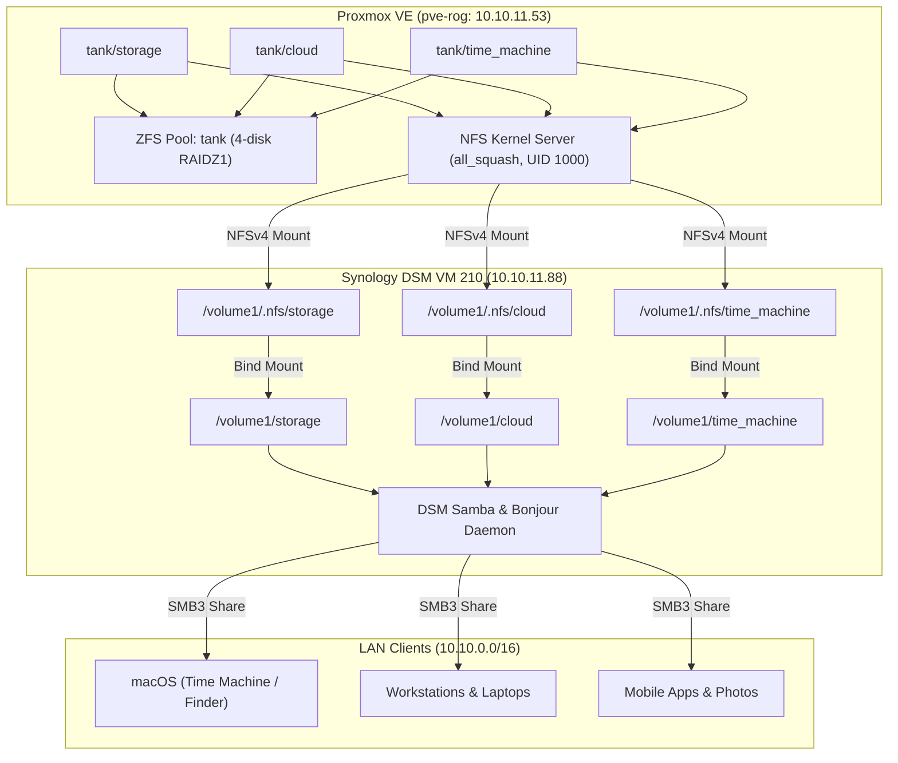

# Synology DSM VM & Proxmox ZFS Storage Runbook

This guide documents the architecture, setup procedures, and automation strategy for running Synology DiskStation Manager (DSM) as a virtual machine on Proxmox VE backed by a host-managed ZFS pool.

---

## 1. Architecture Overview

### Why Option A (ZFS on Host + NFS Export + Bind-Mount into DSM)?

When integrating a multi-disk storage array on Proxmox with Synology DSM, three main approaches exist:
1. **Raw Controller / Disk Passthrough**: Passing the SATA/SAS controller or disks directly to DSM.
   - *Downside*: Locks all disks into Synology's proprietary mdraid/ext4/btrfs format, losing Proxmox ZFS pooling, ARC caching, native snapshot replication, and bitrot scrubbing across other VMs/LXCs.
2. **Monolithic Virtual Disk (zvol)**: Passing a massive (e.g., 8 TB) virtual disk file on ZFS to DSM.
   - *Downside*: Suffers from "filesystem-on-filesystem" amplification, double-caching overhead, and rigid size allocations. Furthermore, Proxmox thick zvols by default reserve `volsize * parity` raw space (`refreservation`), instantly consuming the entire pool.
3. **Hybrid Option A (Host ZFS + NFS + DSM Bind-Mount)**:
   - ZFS manages the physical disks directly on Proxmox (`pve-rog`). Bitrot protection, auto-scrubbing, snapshots, and pool flexibility are preserved.
   - Specific datasets (`storage`, `cloud`, `time_machine`) are exported over the trusted local network via NFS.
   - Synology DSM mounts the NFS exports into staging directories and bind-mounts them into its native Shared Folders (`/volume1/*`).
   - Synology DSM acts as the dedicated NAS service frontend: handling SMB file sharing, macOS Bonjour Time Machine auto-discovery, quota management, and cloud syncing for LAN clients.



---

## 2. Key Insights & Gotchas

### 1. ZFS `refreservation` on Proxmox Virtual Disks
When Proxmox creates a zvol on a ZFS pool without explicitly specifying thin provisioning, ZFS automatically allocates a `refreservation` equal to the volume size plus parity margins. For a 2 TB disk on a RAIDZ1 pool, this reserved **over 2.13 TB of raw pool space** even when the guest disk contained only 37 GB of data.
- **Fix**: Clear the reservation on the host:
  ```bash
  zfs set refreservation=none tank/vm-210-disk-0
  ```
- **Guest TRIM/Discard**: Ensure `discard=on` is set on the Proxmox drive definition:
  ```bash
  qm set 210 -sata1 tank-pool:vm-210-disk-0,discard=on,size=2000G
  ```

### 2. DSM Staged Bind-Mounts vs. Direct Remote Mounts
Synology DSM does not natively expose remote NFS mounts as top-level Shared Folders in the DSM Web UI for macOS Time Machine or SMB sharing.
- **Solution**: Create the shared folders normally in DSM (`/volume1/storage`, `/volume1/cloud`, `/volume1/time_machine`). Mount the NFS exports to a hidden staging directory (`/volume1/.nfs/*`), and then `mount --bind` the staged NFS directories over `/volume1/*`. DSM Samba immediately recognizes the directories as local and serves them with full Bonjour/Time Machine capabilities.

### 3. Permissions Squashing (`all_squash`)
To prevent UID mismatches between Synology DSM internal users and Proxmox/NixOS users, the NFS exports map all incoming client traffic to UID `1000` / GID `1000` (`deepwatrcreatur`). Any file created from DSM or via SMB writes to the underlying ZFS pool with UID `1000`, allowing seamless local access across LXCs, Docker containers, and workstations.

### 4. Synology User Home Directory Quirk
When connecting to DSM via SSH as a non-root admin (`deepwatrcreatur`), DSM displays:
`Could not chdir to home directory /var/services/homes/deepwatrcreatur: No such file or directory`
This occurs because the DSM "User Home" service is disabled by default. While SSH key authentication functions properly even without a home directory (falling back to `/`), the message can be silenced by enabling **Control Panel → User & Group → Advanced → User Home service**.

---

## 3. Step-by-Step Runbook

### Phase 1: Proxmox Host Configuration (`pve-rog`)

1. **Create ZFS Datasets**:
   ```bash
   zfs create tank/storage
   zfs create tank/cloud
   zfs create tank/time_machine

   # Set ownership to standard homelab user (UID 1000)
   chown -R 1000:1000 /tank/storage /tank/cloud /tank/time_machine
   chmod 775 /tank/storage /tank/cloud /tank/time_machine
   ```

2. **Configure NFS Kernel Exports**:
   Add the following exports to `/etc/exports`:
   ```text
   /tank/storage 10.10.0.0/16(rw,sync,no_subtree_check,all_squash,anonuid=1000,anongid=1000)
   /tank/cloud 10.10.0.0/16(rw,sync,no_subtree_check,all_squash,anonuid=1000,anongid=1000)
   /tank/time_machine 10.10.0.0/16(rw,sync,no_subtree_check,all_squash,anonuid=1000,anongid=1000)
   ```
   Apply exports:
   ```bash
   exportfs -rav
   ```

3. **Reclaim Sparse zvol Space**:
   ```bash
   zfs set refreservation=none tank/vm-210-disk-0
   qm set 210 -sata1 tank-pool:vm-210-disk-0,discard=on,size=2000G
   ```

---

### Phase 2: Synology DSM Guest Setup (`10.10.11.88`)

1. **Enable SSH & Install Keys**:
   - In DSM **Control Panel → Terminal & SNMP**, enable SSH on port 22.
   - Install homelab SSH keys to `/root/.ssh/authorized_keys` and the admin user.

2. **Enable Passwordless sudo**:
   Create `/etc/sudoers.d/deepwatrcreatur`:
   ```text
   deepwatrcreatur ALL=(ALL) NOPASSWD: ALL
   ```
   Set permissions:
   ```bash
   chmod 440 /etc/sudoers.d/deepwatrcreatur
   ```

3. **Create Shared Folders in DSM GUI**:
   - Open DSM Web UI (`https://10.10.11.88:5001`).
   - Go to **Control Panel → Shared Folder** and create:
     - `storage`
     - `cloud`
     - `time_machine`
   - Grant `deepwatrcreatur` Read/Write permissions.

4. **Install Persistent Boot Mount Script**:
   Create `/usr/local/bin/mount-zfs-shares.sh`:
   ```bash
   #!/bin/sh
   ### Mount ZFS NFS shares from pve-rog into Synology DSM shared folders

   NFS_HOST="10.10.11.53"
   STAGING_BASE="/volume1/.nfs"
   TARGET_BASE="/volume1"
   SHARES="storage cloud time_machine"

   case "$1" in
     start)
       echo "Mounting ZFS NFS shares..."
       for share in $SHARES; do
         mkdir -p "${STAGING_BASE}/${share}"
         mkdir -p "${TARGET_BASE}/${share}"

         # Mount NFS to staging if not mounted
         if ! grep -qs "${STAGING_BASE}/${share}" /proc/mounts; then
           mount -t nfs -o vers=4,proto=tcp,hard,intr,noatime "${NFS_HOST}:/tank/${share}" "${STAGING_BASE}/${share}"
         fi

         # Bind-mount staging to shared folder if not mounted
         if ! grep -qs "${TARGET_BASE}/${share}" /proc/mounts; then
           mount --bind "${STAGING_BASE}/${share}" "${TARGET_BASE}/${share}"
         fi
       done
       echo "All ZFS shares mounted successfully."
       ;;
     stop)
       echo "Unmounting ZFS shares..."
       for share in $SHARES; do
         umount -f "${TARGET_BASE}/${share}" 2>/dev/null
         umount -f "${STAGING_BASE}/${share}" 2>/dev/null
       done
       ;;
     status)
       df -h | grep -E "(storage|cloud|time_machine)"
       ;;
     *)
       echo "Usage: $0 {start|stop|status}"
       exit 1
       ;;
   esac
   ```
   Make executable:
   ```bash
   chmod +x /usr/local/bin/mount-zfs-shares.sh
   ```

5. **Register Boot Hook**:
   Symlink into DSM's service runner:
   ```bash
   ln -sf /usr/local/bin/mount-zfs-shares.sh /usr/local/etc/rc.d/S99mount-zfs-shares.sh
   ```

---

### Phase 3: DSM GUI File Services & Time Machine Configuration

1. **Enable SMB**:
   - In **Control Panel → File Services → SMB**, enable the SMB service.
   - Set maximum SMB protocol to SMB3.
2. **Enable Bonjour Time Machine Broadcast**:
   - Go to **Control Panel → File Services → Advanced → Time Machine**.
   - Check **Enable Bonjour Time Machine broadcast via SMB**.
   - Click **Set Time Machine Folders**.
   - Select `time_machine` and optionally set a backup quota limit (e.g., 2000 GB).

---

## 4. Automation & OpenTofu Strategy

### Division of Responsibilities

| Layer | Recommended Tool | Rationale |
|---|---|---|
| **Proxmox VM 210 Provisioning** | **OpenTofu (`bpg/proxmox`)** | Declaratively tracks VM specs (cores, memory, MAC address, hardware bus, network bridge). |
| **Proxmox ZFS & NFS Exports** | **Ansible Playbook / NixOS** | Hypervisor OS configuration; managed via Ansible today, or native NixOS when baremetal. |
| **Synology DSM Guest Configuration** | **Bootstrap Script / DSM Task Scheduler** | DSM is a proprietary embedded OS. Deep OS configs (sudoers, rc.d) are best handled via idempotent shell scripts or DSM Task Scheduler. |
| **DSM GUI Settings & Permissions** | **DSM Configuration Backup (`.dss`)** | Synology native backup captures users, shares, and Time Machine settings with 1-click restore. |

### Sample OpenTofu Configuration for Synology DSM VM

Below is a reference OpenTofu configuration using the `bpg/proxmox` provider to declaratively define the DSM VM:

```hcl
terraform {
  required_version = ">= 1.8.0"
  required_providers {
    proxmox = {
      source  = "bpg/proxmox"
      version = ">= 0.60.0"
    }
  }
}

variable "proxmox_endpoint" {
  type    = string
  default = "https://10.10.11.53:8006/"
}

resource "proxmox_virtual_environment_vm" "synology_dsm" {
  node_name = "pve-rog"
  vm_id     = 210
  name      = "synology-dsm"
  started   = true
  on_boot   = true

  operating_system {
    type = "l26" # Linux 2.6/3.x/4.x/5.x/6.x kernel
  }

  cpu {
    cores = 4
    type  = "host"
  }

  memory {
    dedicated = 4096
  }

  # Primary OS boot drive
  disk {
    datastore_id = "local-lvm"
    interface    = "sata0"
    size         = 32
  }

  # Thin data disk on ZFS pool (discard enabled)
  disk {
    datastore_id = "tank-pool"
    interface    = "sata1"
    size         = 2000
    discard      = "on"
  }

  network_device {
    bridge      = "vmbr0"
    mac_address = "BC:24:11:53:D5:D0"
    model       = "virtio"
  }
}
```

---

## 5. Disaster Recovery & Migration Checklist

If migrating the DSM VM to another host (e.g., migrating `pve-strix` → `pve-rog` or baremetal NixOS):

1. **ZFS Dataset Migration**:
   - `zfs snapshot -r tank/storage@migration`
   - `zfs send -R tank/storage@migration | ssh <new-host> zfs recv <target-pool>/storage`
   - (Repeat for `cloud` and `time_machine`).
2. **Re-export NFS on New Host**:
   - Update `/etc/exports` on the new host with matching `all_squash,anonuid=1000,anongid=1000`.
3. **Update Mount Script on DSM**:
   - If the NFS server IP changes, update `NFS_HOST` in `/usr/local/bin/mount-zfs-shares.sh` and restart the service:
     ```bash
     ssh root@10.10.11.88 "/usr/local/bin/mount-zfs-shares.sh start"
     ```
4. **Fleet Inventory**:
   - Verify `dsm` and `synology` entries in [`lib/hosts.nix`](file:///home/deepwatrcreatur/flakes-worktrees/unified-nix-configuration/main/lib/hosts.nix).
